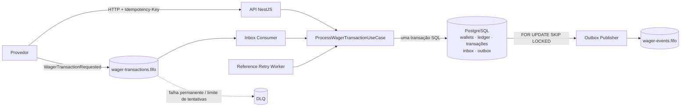
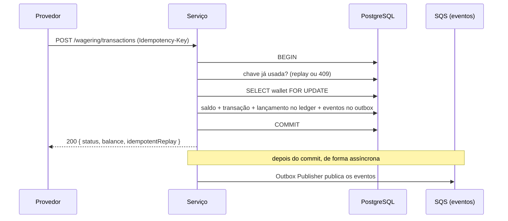

# Financial Wallet

Serviço de carteira financeira que processa transações de apostas vindas de vários provedores de jogos, por HTTP ou por fila SQS.

O foco não é o CRUD. É manter o saldo correto quando as coisas dão errado: mensagens duplicadas, operações que chegam fora de ordem, várias instâncias mexendo na mesma carteira ao mesmo tempo, processo que morre no meio de uma transação, banco ou fila fora do ar por alguns segundos.

A regra que guiou o projeto: **quem garante a correção é o PostgreSQL**. Locks, constraints, triggers e transações fazem esse trabalho; memória e ordem de entrega do broker não são usadas como garantia. Por isso qualquer número de instâncias pode rodar lado a lado.

```
BET → WIN | LOSS | REFUND | ROLLBACK
```

## Sumário

- [O que o sistema garante](#o-que-o-sistema-garante)
- [Stack](#stack)
- [Arquitetura](#arquitetura)
- [Como rodar](#como-rodar)
- [Usando a API](#usando-a-api)
- [Mensageria](#mensageria)
- [Testes](#testes)
- [Desempenho](#desempenho)
- [Observabilidade](#observabilidade)
- [Principais decisões](#principais-decisões)
- [Documentação](#documentação)
- [Estrutura do projeto](#estrutura-do-projeto)
- [Limitações conhecidas](#limitações-conhecidas)

## O que o sistema garante

| Garantia | Como |
|---|---|
| Dinheiro nunca é `number` | `Money` sobre Decimal.js; string decimal com 2 casas no JSON; `numeric(20,2)` no banco |
| Saldo nunca fica negativo | Regra no domínio e `CHECK (balance >= 0)` no banco |
| Nenhum débito ou crédito duplicado | Idempotência persistente: `UNIQUE (provider_id, idempotency_key)` + hash SHA-256 do payload canônico |
| Sem *lost update*, mesmo com várias instâncias | `SELECT … FOR UPDATE` por carteira + trigger que exige `version + 1` a cada mudança de saldo |
| Ledger auditável e imutável | Toda mudança de saldo tem um lançamento; triggers bloqueiam `UPDATE`, `DELETE` e `TRUNCATE` |
| Nenhum evento confirmado se perde | Transactional Outbox na mesma transação SQL da mudança; publicação só depois do commit |
| Mensagem reentregue não reaplica efeito | Inbox persistente por `(consumer, messageId)`; ack no SQS só depois do commit |
| Operação fora de ordem é tratada | REFUND/ROLLBACK antes da referência ficam `PENDING_REFERENCE` e são reprocessados com backoff |

## Stack

**Bun 1.x** · **TypeScript** (strict) · **NestJS** · **PostgreSQL 17** · **MikroORM 7** · **Decimal.js** · **AWS SQS** via LocalStack · **Docker Compose**

## Arquitetura



HTTP e SQS chamam **o mesmo caso de uso**, com a mesma validação. Não existe um caminho "rápido" que pule alguma regra.

O código segue camadas simples:

```
domain  ←  application  ←  infrastructure / interfaces
```

O `domain` (Money, Wallet, WagerTransaction, LedgerEntry, InboxMessage, OutboxMessage) não conhece NestJS, ORM nem AWS. As regras de negócio ficam encapsuladas nas entidades, com construtor privado, factories (`create`, `open`, `rehydrate`) e transições explícitas.

### O caminho de uma aposta



## Como rodar

**Pré-requisitos:** Bun 1.x, Docker e Docker Compose.

> **Sobre o LocalStack:** as imagens recentes do LocalStack exigem um token gratuito. Crie um em [app.localstack.cloud](https://app.localstack.cloud) e coloque em `LOCALSTACK_AUTH_TOKEN` no `.env`. Sem ele, o container das filas não sobe.

### Com Docker (3 instâncias)

```bash
cp .env.example .env
docker compose --profile app up -d --build --scale app=3
```

O serviço `migrate` aplica as migrations antes das instâncias subirem. As três réplicas disputam as mesmas filas e o mesmo banco, e cada uma fica numa porta entre `3000` e `3010` (`docker compose ps` mostra qual).

### Local, para desenvolvimento

```bash
cp .env.example .env
bun install
docker compose up -d postgres localstack
bun run db:migrate
bun run start:dev
```

### Conferindo

```bash
curl localhost:3000/health/ready   # {"status":"ready","dependencies":{"postgres":"up","sqs":"up"}}
```

### Variáveis de ambiente

Todas estão comentadas no [`.env.example`](.env.example). As principais:

| Variável | Uso |
|---|---|
| `POSTGRES_*` | Conexão com o banco |
| `SQS_ENDPOINT`, `AWS_*` | LocalStack |
| `SQS_WAGER_TRANSACTIONS_QUEUE_URL` / `_DLQ_URL` | Fila de entrada (comandos dos provedores) e sua DLQ |
| `SQS_WAGER_EVENTS_QUEUE_URL` / `_DLQ_URL` | Fila de saída (eventos do outbox) e sua DLQ |
| `INBOX_*`, `OUTBOX_*`, `REFERENCE_RETRY_*` | Intervalos, lotes, limites de tentativa e backoff dos workers |

As filas de entrada e de saída precisam ser diferentes: se o serviço publicasse eventos na fila que ele mesmo consome, leria os próprios eventos. Por isso a aplicação se recusa a iniciar quando as duas apontam para a mesma URL.

## Usando a API

Contrato completo em [docs/API.md](docs/API.md).

```bash
# 1. Abrir uma carteira com saldo inicial (gera a transação interna OPENING + crédito no ledger)
curl -X POST localhost:3000/wallets \
  -H 'content-type: application/json' \
  -d '{"playerId":"player-1","initialBalance":{"amount":"100.00","currency":"BRL"}}'

# 2. Apostar
curl -X POST localhost:3000/wagering/transactions \
  -H 'content-type: application/json' \
  -H 'Idempotency-Key: provider-a:tx-1' \
  -d '{"providerId":"provider-a","externalTransactionId":"tx-1","playerId":"player-1",
       "walletId":"<id da carteira>","roundId":"round-1","gameId":"game-1","kind":"BET",
       "money":{"amount":"25.00","currency":"BRL"}}'

# 3. Repetir a mesma requisição devolve o resultado original, com "idempotentReplay": true

# 4. Conferir o saldo contra o ledger
curl -X POST localhost:3000/wallets/<id>/reconciliation
```

| Rota | Descrição |
|---|---|
| `POST /wallets` | Abre uma carteira |
| `GET /wallets/:id` | Saldo e versão |
| `GET /wallets/:id/ledger?cursor=&limit=` | Extrato com cursor estável |
| `POST /wallets/:id/reconciliation` | Reconstrói o saldo pelo ledger e compara |
| `POST /wagering/transactions` | Processa BET, WIN, LOSS, REFUND ou ROLLBACK (`Idempotency-Key` obrigatório) |
| `GET /wagering/transactions/:id` | Consulta pelo id interno |
| `GET /providers/:providerId/wagering/transactions/:externalId` | Consulta pelo id do provedor |
| `GET /health/live`, `GET /health/ready`, `GET /metrics` | Operação |

Cada situação tem um status próprio, para o provedor decidir se reenvia sem precisar ler mensagem de erro:

| Status | Significado | O provedor deve |
|---:|---|---|
| 200 | Processada (ou replay idempotente) | Seguir |
| 202 | Aceita, aguardando a transação referenciada | Consultar depois |
| 400 | Payload inválido | Corrigir; não reenviar igual |
| 404 | Carteira ou transação inexistente | Corrigir o identificador |
| 409 | Mesma chave com outro payload, ou id externo já usado | Não reenviar igual |
| 422 | Recusa de negócio, com `failureCode` (ex.: `INSUFFICIENT_FUNDS`) | Não reenviar igual |
| 503 | Banco ou fila indisponível (`Retry-After`) | Reenviar com a **mesma** chave |

## Mensageria

| Fila | Sentido | DLQ |
|---|---|---|
| `wager-transactions.fifo` | provedor → serviço | `wager-transactions-dlq.fifo` |
| `wager-events.fifo` | serviço → consumidores | `wager-events-dlq.fifo` |

Mensagem de entrada:

```json
{
  "messageId": "msg-123",
  "type": "WagerTransactionRequested",
  "occurredAt": "2026-07-29T15:00:00.000Z",
  "data": {
    "providerId": "provider-a",
    "externalTransactionId": "transaction-123",
    "idempotencyKey": "provider-a:transaction-123",
    "playerId": "player-1",
    "walletId": "<uuid>",
    "roundId": "round-987",
    "gameId": "fortune-chimp",
    "kind": "BET",
    "money": { "amount": "25.00", "currency": "BRL" }
  }
}
```

O consumer separa três tipos de falha:

- **Permanente** (JSON inválido, campo faltando): vai direto para a DLQ, porque reprocessar não vai resolver.
- **Negócio** (saldo insuficiente, por exemplo): ack. A recusa fica registrada e auditável.
- **Transitória** (banco fora, timeout): sem ack, nova tentativa com backoff e DLQ depois de 5 recebimentos.

Eventos publicados: `WagerTransactionProcessed`, `WagerTransactionRejected`, `WagerTransactionPendingReference` e `WalletBalanceChanged`. Cada um tem um `eventId` único, usado também como `MessageDeduplicationId`. A entrega é *at-least-once*, então consumidores devem deduplicar por `eventId`.

## Testes

```bash
bun run typecheck
bun run lint
bun run test                         # unitários, sem dependências externas

docker compose up -d postgres localstack
bun run db:migrate:test              # prepara o banco financial_wallet_test
bun run test:integration             # PostgreSQL real
bun run test:integration:messaging   # PostgreSQL + SQS reais
bun run test:multi-instance          # 3 processos da API contra o mesmo banco
bun run test:e2e                     # HTTP ponta a ponta
bun run test:all                     # tudo junto: 330 testes
```

Nenhum teste de integração substitui o PostgreSQL ou o SQS por mocks. Entre os cenários cobertos:

- saldo de 100,00 e duas apostas de 80,00 simultâneas: uma passa, a outra é recusada, saldo final 20,00 e um único débito no ledger;
- a mesma aposta enviada 50 vezes em paralelo gera um único débito;
- carteiras diferentes processadas em paralelo, sem uma bloquear a outra;
- três processos da API ao mesmo tempo;
- uma instância derrubada com `SIGKILL` com requisições em andamento, reiniciada e com o cliente reenviando: saldo final exato;
- processo que morre antes do commit (nada é gravado) e depois do commit, antes do ack (a reentrega não duplica);
- dois publishers do outbox concorrendo sem publicar o mesmo evento duas vezes;
- REFUND e ROLLBACK que chegam antes da aposta referenciada, inclusive com dois workers disputando a mesma linha;
- constraints e triggers do schema, e migrations que sobem e descem.

Todo teste que usa o banco termina conferindo a invariante central:

```
wallet.balance == saldo reconstruído a partir do ledger
```

## Desempenho

O teste de carga (`bun run test:load`) foi executado com 3 instâncias da API: 2.000 apostas, 50 em paralelo e 10% de reenvios com a mesma chave.

| Cenário | Throughput | p50 | p95 | p99 | Erros | Débitos duplicados |
|---|---|---|---|---|---|---|
| Carga distribuída | 331 req/s | 139 ms | 274 ms | 356 ms | 0% | 0 |
| 20% numa única carteira "quente" | 246 req/s | 127 ms | 618 ms | 903 ms | 0% | 0 |

A carteira quente dobra a latência de cauda, e isso é esperado: operações da mesma carteira são serializadas de propósito. Em ambos os cenários todas as carteiras terminaram reconciliadas. O ambiente, a metodologia e a análise completa (incluindo o lag do outbox) estão no [ARCHITECTURE.md](ARCHITECTURE.md), seção 19.

## Observabilidade

- **Logs** em JSON com `correlationId`, `messageId`, `transactionId`, `walletId` e `providerId`. Valores monetários e payloads completos não vão para o log.
- **Métricas** no formato Prometheus em `GET /metrics`: transações por status, duplicatas, conflitos de idempotência, retries, mensagens em DLQ, conflitos e espera de lock, latência de processamento, backlog e lag do outbox, divergências de reconciliação.
- **Health checks** separados: `/health/live` (processo de pé) e `/health/ready` (PostgreSQL e filas alcançáveis).

## Principais decisões

| Decisão | Por quê | Detalhes |
|---|---|---|
| Lock pessimista por carteira | Apostas do mesmo jogador chegam em rajada; lock otimista viraria uma tempestade de retries. O lock é do banco, então vale entre instâncias, e carteiras diferentes não se bloqueiam | ARCHITECTURE §5 |
| Trigger de versão como rede de segurança | Se algum código esquecer o lock, o banco recusa a escrita em vez de perder uma atualização em silêncio | §5 |
| `wallet_version` como ordem do ledger | Timestamps empatam e dependem de relógio; a versão cresce de 1 em 1 sob o lock | §7 |
| Idempotência no banco, com hash do payload | Sobrevive a restart e vale entre instâncias; mesma chave com outro payload é conflito, não replay | §6 |
| Inbox e Outbox transacionais | Sem *dual write*: ou tudo é confirmado junto, ou nada é | §10, §11 |
| Evento que falha muito nunca é descartado | Ele já foi confirmado junto com a transação financeira; fica em retentativa lenta e dispara alerta | §11 |
| Uma reversão por referência | Interpretação mais segura de uma regra ambígua; evita creditar a mesma aposta duas vezes | §8 |
| MikroORM | Unit of Work e Identity Map explícitos, transação por `EntityManager` isolado e locks de primeira classe | §2.1 |
| Autenticação fora do escopo | O enunciado permite; ponto de extensão no código e desenho OIDC documentado | §16 |

## Documentação

O documento central do projeto é o **[ARCHITECTURE.md](ARCHITECTURE.md)**. Ele explica cada decisão, as alternativas descartadas e o custo de cada escolha:

| Seção | Assunto |
|---|---|
| 1–3 | Princípios, stack, por que MikroORM e como as camadas se organizam |
| 4–7 | Dinheiro, concorrência, idempotência e ledger |
| 8–9 | Regras de negócio, códigos de falha, máquina de estados e referências fora de ordem |
| 10–12 | Inbox, Outbox, filas e classificação de falhas |
| 13–16 | Contrato HTTP, observabilidade, desligamento gracioso e autenticação |
| 17–19 | Estratégia de testes, limitações e o teste de carga |

Também fazem parte:

- **[docs/API.md](docs/API.md):** contrato HTTP, com exemplos, códigos de status e de falha.
- **[docs/IMPLEMENTATION_STATUS.md](docs/IMPLEMENTATION_STATUS.md):** cada requisito do desafio ligado à implementação e ao teste que o comprova.

## Estrutura do projeto

```
src/
  domain/           entidades e regras de negócio (sem framework)
  application/      casos de uso, portas, validação e workers (inbox, outbox, referências)
  infrastructure/   MikroORM (entidades, repositórios, Unit of Work), SQS, logs e métricas
  interfaces/http/  controllers, DTOs e tratamento de erros
  migrations/       schema, constraints e triggers versionados
test/
  unit/             domínio, casos de uso e workers
  integration/      PostgreSQL, SQS e múltiplas instâncias
  e2e/              API HTTP
scripts/            teste de carga
docker/             criação das filas no LocalStack
```

## Limitações conhecidas

- **Autenticação** não foi implementada (o desafio permite). Existe um guard sem efeito e uma porta de identidade prontos para um adaptador OIDC. Não exponha a API numa rede não confiável assim.
- **Carteira quente:** operações da mesma carteira são serializadas, então uma carteira muito disputada tem latência maior. É o preço da correção.
- **Outbox at-least-once:** consumidores dos eventos precisam deduplicar por `eventId`.
- **Métricas por instância:** cada réplica expõe as suas; a agregação fica a cargo do Prometheus.
